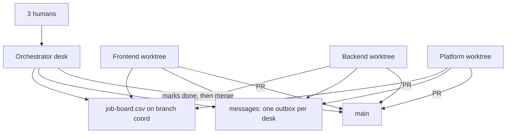

# Hackathon Agents

A starter kit for a 3-person team that wants four coding agents on one hackathon project: an orchestrator, a frontend desk, a backend desk, and a platform desk (auth, data, env, CI, deploy). The agents coordinate through a job board you can open in Excel, and through short files they append to. The kit is framework-agnostic and MIT licensed.

It does not ship a product, a model router, or a hosted orchestrator. You drop these files into your repo, fill in `PROJECT.md`, and start four sessions.

```text
        3 humans (any of them can type into any desk)
                      |
                      v
              +---------------+
              | orchestrator  |  pitch, tasks, accept/reject
              +-------+-------+
                      | writes tasks, marks done
                      v
            coordination/job-board.csv     <-- open this in Excel
            (live copy on branch coord)
             ^     ^      ^      ^
             |     |      |      |  claim by writing your name
        +----+  +--+   +--+   +--+----+
        | front| |back| |plat| | orch |   each in its own git worktree
        +------+ +----+ +----+ +------+
             \      |      |      /
              \     |      |     /   PRs into main, after review
               +----+------+----+
                    | main |
                    +------+

        coordination/messages/<desk>.md    each desk appends only to its own file
```



## Start here

From a git repo that already has one commit (this one, or your app after you copy these files in):

```bash
./scripts/setup.sh
```

That creates five worktrees:

| Folder | Branch | Desk |
| --- | --- | --- |
| `.worktrees/coord` | `coord` | Live board and outboxes. No product code. |
| `.worktrees/orchestrator` | `desk/orchestrator` | Orchestrator |
| `.worktrees/frontend` | `desk/frontend` | Frontend |
| `.worktrees/backend` | `desk/backend` | Backend |
| `.worktrees/platform` | `desk/platform` | Platform |

Open the board in Excel:

```text
.worktrees/coord/coordination/job-board.csv
```

For a colored sheet with a frozen header and a legend, generate a workbook. The CSV stays the file agents edit. Do not round-trip the `.xlsx` back.

```bash
python3 scripts/board.py render
```

Print the launch command for each desk. This works with no CLI installed. Add `--start claude` (or `codex`, `hermes`, `cursor`) when that program is on your `PATH`.

```bash
./scripts/launch.sh orchestrator --print
./scripts/launch.sh frontend --print
./scripts/launch.sh backend --print
./scripts/launch.sh platform --print
```

Then, as a human, with the orchestrator session:

1. Fill in `PROJECT.md` and `demo/SCRIPT.md`.
2. Replace the sample rows. Their notes start with `EXAMPLE`.

```bash
python3 scripts/board.py drop-examples --as orchestrator --yes
python3 scripts/board.py add --as orchestrator --role frontend --priority P0 \
  --paths "web/" --status ready \
  --task "Demo screen for step 1 of demo/SCRIPT.md, mocked data is fine."
```

Checklists: [before the event](checklists/pre-hackathon.md), [during the event](checklists/during-hackathon.md).

Confirm the scripts on a disposable copy:

```bash
./scripts/smoke.sh
```

## How a task moves

Nobody edits product code until their name is on the row.

```bash
python3 scripts/board.py claim T-004 --as backend
git checkout -B agent/backend/T-004 origin/main
python3 scripts/board.py start T-004 --as backend --branch agent/backend/T-004
# ...build, run the test command in PROJECT.md, open a PR...
python3 scripts/board.py review T-004 --as backend --pr "https://github.com/org/repo/pull/12"
python3 scripts/board.py done T-004 --as orchestrator
```

`claim` fails if another desk already owns the row, or if `depends_on` is not all `done`. A desk cannot mark its own task `done`. That lock covers the desks on one machine. If the team spreads desks over several laptops, follow [More than one laptop](coordination/RULES.md#more-than-one-laptop). The columns are `id`, `task`, `role`, `owner`, `status`, `priority`, `depends_on`, `branch`, `pr`, `owned_paths`, `notes`, `updated`. The full contract is [coordination/RULES.md](coordination/RULES.md). The short version every agent loads is [AGENTS.md](AGENTS.md).

Talk to another desk by appending to your own outbox:

```bash
python3 scripts/post.py --from backend --to frontend --task T-004 \
  --body "GET /api/items returns {items:[{id,name}]}."
python3 scripts/board.py messages   # every outbox, from the live coord copy
```

A human can take over a row (`owner` = `human:name`), write a note that starts with `HUMAN:`, or halt every desk:

```bash
python3 scripts/board.py claim T-004 --as human:laith
python3 scripts/board.py stop --as orchestrator --note "Freeze. Demo breaks only."
python3 scripts/board.py go --as orchestrator
```

## Why it is shaped this way

Four agents in one working directory overwrite each other. Git worktrees give each desk its own files and its own index. A worktree does not tell the others what you decided, so the board and the outboxes are the shared memory, and they live on one branch (`coord`) so claims do not fork into four copies of the sheet.

File fights that survive worktrees are avoided by `owned_paths`, one branch per task (`agent/<desk>/<id>`), and merging only through `main` after the orchestrator accepts the row. The CSV is what agents edit, because a workbook diffs badly. Excel still opens the CSV. The render script is there when a person wants colors.

## Which tool reads which file

| Tool | What to open |
| --- | --- |
| Claude Code | `CLAUDE.md`, plus `.claude/agents/` if you delegate inside one session, and `.claude/skills/job-board/` |
| Codex | `AGENTS.md` |
| Cursor | `AGENTS.md` and `.cursor/rules/hackathon-desk.mdc` |
| Hermes Agent | `AGENTS.md` (it prefers this over `CLAUDE.md` when both exist) |

The intended setup is four sessions, one per worktree. Claude's experimental agent teams are a different product feature: a lead and teammates in one Claude Code session, with their own task list. This kit does not require that flag. Use it only if every desk is Claude and you have read the current docs. Those teammates are not given separate worktrees, so the file-ownership rules still apply. Docs: [worktrees](https://code.claude.com/docs/en/worktrees), [agent teams](https://code.claude.com/docs/en/agent-teams).

`./scripts/launch.sh frontend --print` shows a first prompt you can paste into any of the four tools.

## Copy the kit into an existing app

Copy everything except `.git/` into your project, commit, then run `./scripts/setup.sh`. Change the file map in `PROJECT.md` so `owned_paths` match your tree (`apps/web` instead of `web/`, and so on). Delete the `EXAMPLE` board rows once real tasks exist. Keep `scripts/`, `coordination/`, `agents/`, `AGENTS.md`, and `CLAUDE.md`. The sample tasks are scaffolding, not a product.

Requires `git` and `python3`. No pip packages. Shell scripts are bash (macOS, Linux, WSL, or Git Bash).

## Repo map

| Path | What it is |
| --- | --- |
| `AGENTS.md` | Rules Codex, Cursor, and Hermes load. Claude loads them too. |
| `CLAUDE.md` | Claude Code entry. Points at `AGENTS.md`. |
| `agents/*.md` | The four role prompts. |
| `.claude/agents/*.md` | The same desks as Claude Code subagents. |
| `.claude/skills/job-board/` | Skill for board and outbox commands. |
| `.cursor/rules/hackathon-desk.mdc` | Cursor rule that points at the same contract. |
| `coordination/job-board.csv` | Board template, including example rows. |
| `coordination/RULES.md` | Claiming, status flow, handoffs, conflicts, humans. |
| `coordination/messages/` | Outbox per desk. |
| `scripts/setup.sh` | Creates the worktrees. |
| `scripts/launch.sh` | Prints or starts one desk. |
| `scripts/board.py` | Locked updates, validation, `.xlsx` render. |
| `scripts/post.py` | Append one outbox message. |
| `scripts/smoke.sh` | Fresh-clone test of setup, claim, and render. |
| `checklists/` | Before the event, and during it. |
| `PROJECT.md`, `demo/SCRIPT.md` | What the team fills in. Pitch and click path. |
| `.env.example` | Dummy keys only. |

## Credits

This kit copies practices that are already public. It does not report a hackathon result.

- Claude Code docs on [worktrees](https://code.claude.com/docs/en/worktrees) and [agent teams](https://code.claude.com/docs/en/agent-teams): separate checkouts, and a lead whose teammates claim shared tasks. The board here is a CSV so the same claim works in Claude Code, Codex, Cursor, and Hermes Agent.
- [KAVI (@0xKAVI01)](https://x.com/0xKAVI01/status/2116550768840921512), 31 Oct 2026: pointing several coding agents at one folder is how you get a merge-conflict pile. Use `git worktree add`.
- [Foremerge](https://x.com/Foremerge/status/2111428013988499883), 17 Oct 2026: a worktree keeps files apart. It does not tell another agent what was decided.
- [Julien Dubois, Winning the Hackathon](https://www.julien-dubois.com/conferences/winning-the-hackathon/index-en.html): write the agent instructions before you launch anyone, one branch per task, a test command, and nothing on `main` without a review.
- [Pranjul Rathour, The hackathon demo that works live](https://pranjulrathour.github.io/blog/hackathon-demo-that-works-live/): freeze, seed data, have a hotspot, keep a short recording.
- [The Hackathon Playbook cheat sheet](https://thehackathonplaybook.dev/cheat-sheet): after freeze, harden the deployed path. Do not demo localhost.
- [fshot/claude-plugin-hackathoner](https://github.com/fshot/claude-plugin-hackathoner): checkpoint the demo and cut scope on a clock. The during-hackathon list is a shorter version of that idea.
- [Augment Code on git worktrees for parallel agents](https://www.augmentcode.com/guides/git-worktrees-parallel-ai-agent-execution): one worktree per agent, and a test run that was green before the agent started.

## License

[MIT](LICENSE).
